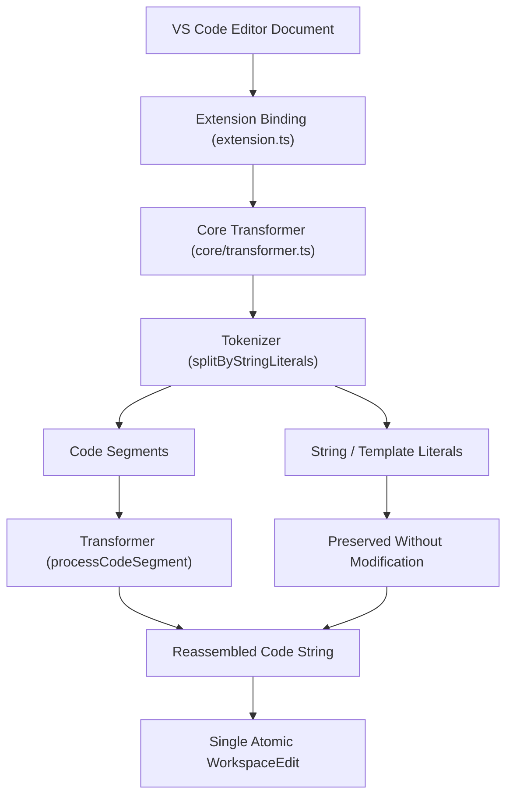

# Architecture of Auto Optional Chainer

This document outlines the internal architecture, design decisions, and execution pipeline of **Auto Optional Chainer** to guide contributors.



## Directory Structure

```
├── .github/              # CI/CD workflows, issue forms, PR templates
├── assets/               # Logo, banners, and animated preview demo
├── src/
│   ├── core/
│   │   └── transformer.ts # Pure transformation and tokenization engine
│   ├── extension.ts      # VS Code extension lifecycle and command handlers
│   └── test/
│       ├── transformer.test.ts # Fast Mocha unit tests
│       └── extension.test.ts   # VS Code integration tests
├── eslint.config.mjs     # ESLint flat configuration
├── tsconfig.json         # TypeScript compiler options
└── package.json          # Extension manifest & scripts
```

## Architecture Layers

### 1. Extension Binding Layer (`src/extension.ts`)

- **`activate(context)`**: Registers commands and workspace listeners:
  - `AutoOptionalChainer.applyOptionalChaining`
  - `onDidSaveTextDocument` (conditionally active when `applyOnSave` is enabled)
- **`isSupportedDocument(document)`**: Validates file language IDs (`javascript`, `typescript`, `javascriptreact`, `typescriptreact`).
- **`applyOptionalChaining(document)`**: Reads the active editor document, invokes `transformSourceCode`, and applies changes as an atomic `vscode.WorkspaceEdit`.

### 2. Core Transformation Engine (`src/core/transformer.ts`)

- Decoupled from the VS Code API so that transformation logic can be tested in milliseconds in any Node environment.
- **`splitByStringLiterals(text)`**: A finite state-machine tokenizer that separates code tokens from single quotes (`'...'`), double quotes (`"..."`), and template literals (`` `...` ``). For template literals, `${...}` interpolation expressions are processed while literal text is preserved.
- **`processCodeSegment(segment, customIgnored?)`**: Iterative processor that safely adds `?.` while respecting:
  - Assignment targets (`user.name = "John"` preserved)
  - Built-in global identifiers (`Math`, `console`, `React`, `JSON`, etc.)
  - Chained properties (`a.b.c -> a?.b?.c`)
- **`transformSourceCode(source, customIgnored?)`**: High-level orchestrator function.

## Testing Strategy

- **Unit Tests**: Run with `npm run test:unit` using Mocha and `c8` coverage. Executes in <10ms with zero Electron overhead.
- **Integration Tests**: Run with `npm test` using `@vscode/test-cli` inside the VS Code development host.
