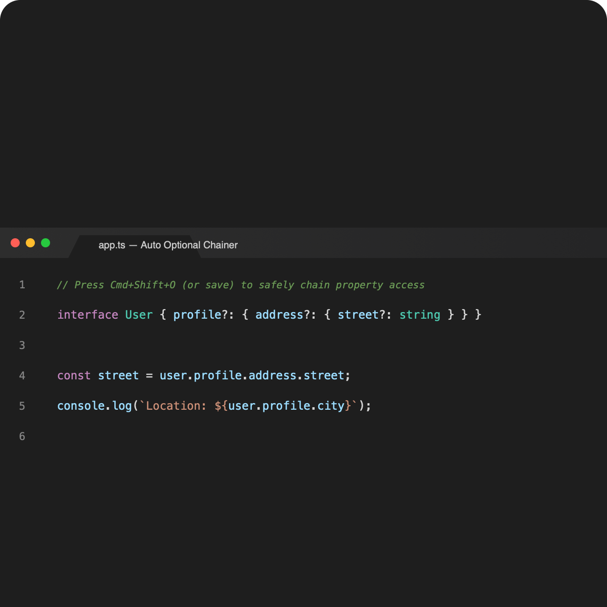

# Auto Optional Chainer

<p align="center">
  
</p>

<p align="center">
  <a href="https://github.com/tafsirc/auto-optional-chainer/actions/workflows/ci.yml"></a>
  <a href="https://marketplace.visualstudio.com/items?itemName=ctafsiras.AutoOptionalChainer"></a>
  <a href="https://marketplace.visualstudio.com/items?itemName=ctafsiras.AutoOptionalChainer"></a>
  <a href="https://marketplace.visualstudio.com/items?itemName=ctafsiras.AutoOptionalChainer"></a>
  <a href="https://github.com/tafsirc/auto-optional-chainer/stargazers"></a>
  <a href="https://github.com/tafsirc/auto-optional-chainer"></a>
  <a href="CONTRIBUTING.md"></a>
  <a href="https://codespaces.new/tafsirc/auto-optional-chainer"></a>
  <a href="LICENSE.md"></a>
</p>

<p align="center">
  
</p>

## Introduction

**Auto Optional Chainer** is a Visual Studio Code extension that automatically adds optional chaining (`?.`) in JavaScript and TypeScript code where needed. This helps prevent runtime errors caused by accessing properties on `undefined` or `null` values.

### Example

**Before:**

```javascript
const street = user.address.street;
```

**After:**

```javascript
const street = user?.address?.street;
```

## Why Auto Optional Chainer?

Accessing deeply nested properties without checks often leads to crashes like `Cannot read properties of undefined (reading 'x')`. Writing `?.` manually across hundreds of lines is tedious, repetitive, and error-prone.

**Auto Optional Chainer** eliminates this friction with a single shortcut (`Cmd+Shift+O` / `Ctrl+Shift+O`) or automatically on save.

### Feature Comparison Matrix

| Scenario / Feature                                      | Manual Typing  | ESLint / Prettier  |  Auto Optional Chainer   |
| :------------------------------------------------------ | :------------: | :----------------: | :----------------------: |
| Deep Property Chaining (`a.b.c -> a?.b?.c`)             |   ⚠️ Tedious   |  ❌ No auto-chain  |        ✅ Instant        |
| Assignment Guard (`user.id = 5` preserved)              | ⚠️ Error-prone |       ❌ N/A       |   ✅ Smart protection    |
| String Literal Protection (`"a.b.c"` untouched)         |   ⚠️ Manual    |       ❌ N/A       |  ✅ Tokenizer preserved  |
| Template Literal Interpolation (`${a.b}`)               |   ⚠️ Manual    |       ❌ N/A       | ✅ Processes expressions |
| Standard Library Protection (`Math.max`, `console.log`) |   ⚠️ Manual    |       ❌ N/A       |     ✅ Auto-ignored      |
| Auto-apply on File Save                                 |   ❌ Manual    | ⚠️ Formatting only |     ✅ Configurable      |

## Features

- Automatically inserts optional chaining in JavaScript and TypeScript files.
- Supports JSX and TSX files.
- Smart detection to avoid modifying console statements and built-in objects (`Math`, `Number`, `String`, `Date`, `React`, `Object`, `Array`, `RegExp`, `JSON`).
- Preserves string literals and template literals while processing interpolated expressions inside them.
- Provides a quick command (`Apply Optional Chaining`) to process the active file.
- Optional auto-apply on file save.
- Configurable keyboard shortcut (Ctrl+Shift+O / Cmd+Shift+O).

## Installation

Install via the VS Code Quick Open:

1. Press `Ctrl+P` (or `Cmd+P` on macOS).
2. Paste the following command and press Enter:
   ```bash
   ext install ctafsiras.AutoOptionalChainer
   ```

Alternatively, search for **Auto Optional Chainer** in the Extensions view (`Ctrl+Shift+X` / `Cmd+Shift+X`).

## Usage

1. Open a JavaScript or TypeScript file in VS Code.
2. Run the command **"Apply Optional Chaining"** from the Command Palette (`Ctrl+Shift+P` / `Cmd+Shift+P`), or press `Ctrl+Shift+O` (`Cmd+Shift+O` on macOS).
   > **Note:** The keyboard shortcut requires enabling `autoOptionalChainer.enableShortcut` in settings first.
3. The extension will update your code with optional chaining where applicable.

## Requirements

- **Visual Studio Code** version **1.96.0** or later.
- **Node.js** and **npm** for development and testing.

## Configuration

This extension provides the following configurable settings in VS Code (`Ctrl+,` or `Cmd+,`):

| Setting                                  |    Type    | Default | Description                                                                              |
| :--------------------------------------- | :--------: | :-----: | :--------------------------------------------------------------------------------------- |
| `autoOptionalChainer.applyOnSave`        | `boolean`  | `false` | Automatically apply optional chaining when saving supported files                        |
| `autoOptionalChainer.enableShortcut`     | `boolean`  | `false` | Enable keyboard shortcut (`Ctrl+Shift+O` / `Cmd+Shift+O`) for applying optional chaining |
| `autoOptionalChainer.ignoreThis`         | `boolean`  | `true`  | Ignore 'this' references to prevent adding optional chaining directly to this            |
| `autoOptionalChainer.ignoredIdentifiers` | `string[]` |  `[]`   | Custom identifiers or global singletons to ignore during optional chaining               |

To modify these settings:

1. Open VS Code Settings (Ctrl+,)
2. Search for "Auto Optional Chainer"
3. Toggle the desired options

## Known Issues

- The extension does not distinguish between optional chaining needed for safe property access and cases where explicit error handling is preferable.
- Complex code structures with dynamically computed properties may not be fully processed.
- Template literals with nested interpolations might require multiple passes for complete processing.

## Release Notes

See [CHANGELOG.md](CHANGELOG.md) for full version history.

### 0.0.7

- Initial release of **AutoOptionalChainer**.
- Supports JavaScript, TypeScript, JSX, and TSX files.
- Processes code while preserving string literals and template interpolations.
- Extended list of ignored identifiers to prevent unnecessary modifications.
- Added configuration options for auto-apply on save and keyboard shortcuts.
- Implemented keyboard shortcut support (Ctrl+Shift+O / Cmd+Shift+O).

## Contributing

Contributions are welcome! Please see [CONTRIBUTING.md](CONTRIBUTING.md) for setup instructions and guidelines, and read our [Code of Conduct](CODE_OF_CONDUCT.md).

## Contributors

Thanks goes to these wonderful people ([emoji key](https://allcontributors.org/docs/en/emoji-key)):

<!-- ALL-CONTRIBUTORS-LIST:START - Do not remove or modify this section -->
<!-- prettier-ignore-start -->
<!-- markdownlint-disable -->
<table>
  <tbody>
    <tr>
      <td align="center" valign="top" width="14.28%"><a href="https://github.com/tafsirc"><br /><sub><b>Tafsir Chowdhury</b></sub></a><br /><a href="https://github.com/tafsirc/auto-optional-chainer/commits?author=tafsirc" title="Code">💻</a> <a href="https://github.com/tafsirc/auto-optional-chainer/commits?author=tafsirc" title="Documentation">📖</a> <a href="#maintenance-tafsirc" title="Maintenance">🚧</a></td>
    </tr>
  </tbody>
</table>

<!-- markdownlint-restore -->
<!-- prettier-ignore-end -->

<!-- ALL-CONTRIBUTORS-LIST:END -->

This project follows the [all-contributors](https://github.com/all-contributors/all-contributors) specification. Contributions of any kind are welcome!

## Security

If you discover a security vulnerability, please review our [Security Policy](SECURITY.md) to report it responsibly.

## Sponsor

If you find this extension helpful, consider supporting its development on [Polar](https://polar.sh/tafsirc).

## Developer

Developed by **Tafsir Chowdhury**. Feel free to visit the [GitHub](https://github.com/tafsirc) profile.

## License

This project is licensed under the [MIT License](LICENSE.md) - see the file for details. Copyright (c) Tafsir Chowdhury.

## Further Reading

- [Visual Studio Code API Documentation](https://code.visualstudio.com/api)
- [TypeScript Handbook](https://www.typescriptlang.org/docs/handbook/intro.html)

**Enjoy coding with AutoOptionalChainer!** 🚀
